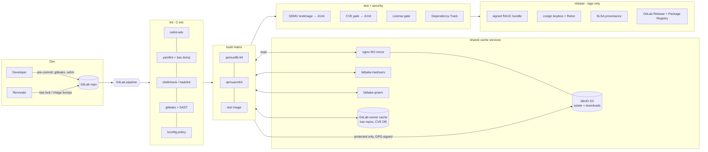

# Architecture



## Repository layout

```
kas/
  base.yml                 Wrynose layers, distro, QA-as-error
  base.lock.yml            (generated) exact commits - `kas lock kas/base.yml`
  machines/                qemux86-64, qemuarm64 (add real BSPs here)
  features/
    ci-cache.yml           L1-L4 cache wiring, signature verification
    sstate-sign.yml        producer-side sstate signing (protected refs)
    security.yml           SPDX, VEX, cve-check, sbom-cve-check, licenses
    test.yml               test-only image tweaks (never released)
    release.yml            meta-rauc, signed bundle, prod hardening
meta-secure-linux/             custom layer: distro, image, agent, kernel, oeqa tests
ci/templates/              pipeline split by concern (included from .gitlab-ci.yml)
ci/scripts/                gates and converters (Python stdlib + PyYAML only)
ci/policies/               kconfig + license policy (CODEOWNERS-protected)
docker/                    build container
infra/                     cache services (compose), runner config, MinIO policies
docs/                      this documentation
```

## Extending to real hardware

Add `kas/machines/<board>.yml` that includes the BSP layer (e.g. `meta-raspberrypi`
or `meta-freescale` for i.MX8). Then add the machine to the `parallel:matrix` in
`ci/templates/build.yml` and `security.yml`. For on-target tests, use LAVA or
labgrid with a runner tagged `hil`.
